# Atrasos de entrega no e-commerce brasileiro: um MVP de pipeline de dados em nuvem

**Universidade de Brasília · Departamento de Engenharia de Produção**
**Aluno:** Filippe Dumont Lana (202024526) · **Professor:** André Luiz Marques Serrano
**Plataforma:** projetado para Google Colab + Google Drive · executado em VM Linux em nuvem ([nota](#2-plataforma-e-arquitetura)) · PySpark 3.5 + Delta Lake 3.2

[](https://colab.research.google.com/github/FilippeDumont/mvp-olist-atrasos-entrega/blob/main/notebooks/00_pipeline.ipynb)

> **Resumo.** Este MVP constrói um pipeline de dados ponta a ponta (coleta → Bronze → Silver → Gold →
> qualidade → análise) sobre cerca de 100 mil pedidos do marketplace Olist, para testar uma hipótese
> de negócio: *o atraso na entrega é o principal fator de insatisfação do cliente e se concentra em
> padrões que podem ser gerenciados.* Os resultados confirmam a maior parte da hipótese:
> - com atraso, a nota baixa sobe de **9%** para **62%** dos pedidos (razão de chances de **18**, controlando outros fatores);
> - os atrasos se concentram no **Nordeste e no Rio de Janeiro**, em **picos de demanda** e em
>   **choques externos**;
> - **72%** dos atrasos acontecem mesmo com o vendedor postando no prazo, o que aponta o
>   **transporte** como a principal alavanca de gestão.

---

## Sumário

1. [Objetivo](#1-objetivo)
2. [Plataforma e arquitetura](#2-plataforma-e-arquitetura)
3. [Busca e coleta dos dados](#3-busca-e-coleta-dos-dados)
4. [Modelagem](#4-modelagem)
5. [Carga (pipeline ETL)](#5-carga-pipeline-etl)
6. [Análise](#6-análise)
7. [Autoavaliação](#7-autoavaliação)
8. [Como reproduzir](#8-como-reproduzir)
9. [Estrutura do repositório](#9-estrutura-do-repositório)
10. [Ética, licenças e proteção de dados](#10-ética-licenças-e-proteção-de-dados)
11. [Referências](#11-referências)

---

## 1. Objetivo

> Esta seção foi escrita **antes** da construção do pipeline e de qualquer análise. Conforme a
> orientação do trabalho, ela se mantém **íntegra**: as perguntas e hipóteses não foram alteradas
> após os resultados, inclusive as que acabaram refutadas, e o atingimento de cada uma é discutido na
> [Autoavaliação](#7-autoavaliação).

### 1.1 Problema

Em um marketplace, a empresa que vende **não controla** o estoque, que é dos vendedores parceiros,
nem a entrega, que é das transportadoras. Mesmo assim, é ela que o cliente avalia. Quando o pedido
atrasa, quem recebe a nota baixa é o marketplace, o que afeta reputação, recompra e posicionamento
nos canais de venda.

O MVP busca responder se o atraso **de fato** destrói a satisfação e se ele é **aleatório** ou se
**concentra em padrões** (onde, quando, em qual elo da cadeia) que permitam agir.

### 1.2 Hipótese de negócio

> **H:** *O atraso na entrega é o principal fator de insatisfação do cliente e se concentra em rotas,
> períodos e elos da cadeia identificáveis. Portanto, é gerenciável com dados.*

**Métrica-chave:** **taxa de atraso**, o percentual de pedidos entregues depois da data prometida
ao cliente, e o seu efeito sobre a **nota de avaliação** (de 1 a 5).

### 1.3 Perguntas de negócio

| # | Pergunta | Hipótese específica | Métrica | Decisão que apoia |
|---|---|---|---|---|
| **P1** | Quanto o atraso custa em satisfação? | Pedidos atrasados recebem notas significativamente piores | Nota média e % de notas 1–2, com e sem atraso | Priorizar (ou não) o prazo como alavanca de satisfação |
| **P2** | Onde o atraso se concentra (UF, região, rota, distância)? | Rotas longas e destinos no Norte e Nordeste atrasam mais | Taxa de atraso por recorte geográfico | Onde negociar acordos de nível de serviço e trocar transportadoras |
| **P3** | Quando o atraso acontece? Está ligado a picos de demanda? | Meses de alto volume saturam a logística | Taxa de atraso mensal × volume | Planejamento de capacidade para datas comerciais |
| **P4** | Quem causa o atraso: o vendedor (postagem) ou o transporte? | O atraso nasce no vendedor, que posta depois do prazo | Participação de cada elo nos atrasos e no tempo excedente | Cobrar vendedores ou gerir transportadoras |
| **P5** | O prazo prometido ao cliente está calibrado? | A promessa é folgada demais e mal distribuída | Folga (prometido − real); simulação de regra alternativa | Como definir a promessa de prazo |
| **P6** | Dá para prever o risco de atraso no momento da compra? *(exploratória)* | Distância, região, época e frete explicam parte do risco | AUC e *lift* fora da amostra | Triagem de pedidos de risco e alerta proativo |

### 1.4 Desenho do MVP (por que isto é um MVP)

| Dimensão | Pergunta | Evidência neste trabalho |
|---|---|---|
| Viabilidade técnica | A solução pode ser construída com a tecnologia disponível? | Pipeline executado ponta a ponta em nuvem, duas vezes, com 25 cargas e todas as verificações aprovadas ([evidências](#57-evidências-de-execução-na-nuvem)) |
| Viabilidade financeira | É economicamente sustentável? | Custo zero de infraestrutura: Colab gratuito e Drive com 15 GB gratuitos para 126 MB brutos e 120 MB no lakehouse |
| Desejabilidade | É o que o "usuário", a operação do marketplace, precisa? | Perguntas ligadas a decisões concretas, respondidas com dados e um plano de ação ([6.3](#63-discussão-geral)) |

---

## 2. Plataforma e arquitetura

O trabalho usa o **Google Colab** como ambiente de processamento, como pedido na disciplina. Como a
máquina do Colab é **apagada** ao fim de cada sessão, o lakehouse fica **persistido no Google Drive**,
em tabelas **Delta Lake**. Cada notebook lê do Drive o que o anterior gravou, o que demonstra na
prática que os dados sobrevivem entre sessões.

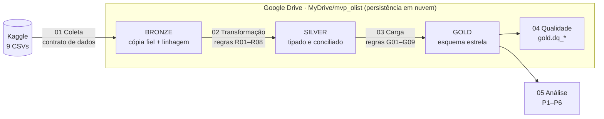

| Componente | Escolha | Justificativa |
|---|---|---|
| Processamento | Google Colab + **PySpark 3.5** | Requisito da disciplina; o Spark mantém o pipeline escalável e com SQL nativo |
| Formato de armazenamento | **Delta Lake 3.2** | Transações ACID, esquema garantido e **histórico de versões** de cada carga (*time travel*) |
| Persistência | **Google Drive** (`MyDrive/mvp_olist/`) | Nuvem gratuita e integrada ao Colab; a persistência é comprovada pelas evidências e pelo histórico de versões Delta |
| Arquitetura | **Medalhão** (Bronze → Silver → Gold) | Separa dado bruto, dado tratado e dado analítico, o que garante rastreabilidade |
| Orquestração | Notebook [`00_pipeline`](notebooks/00_pipeline.ipynb) + log Delta | Executa as etapas em sequência e registra etapa, destino, linhas, duração e status |

**Estratégia de escrita:** cada tabela é gravada primeiro no disco da VM, onde o Delta Lake tem a
renomeação atômica que o protocolo de commit exige, e em seguida sincronizada com o Drive. Os arquivos
Delta são imutáveis, então a sincronização preserva o histórico de versões. Detalhes em
[`scripts/common.py`](scripts/common.py).

> **Nota de transparência sobre o ambiente de execução.** O pipeline foi projetado para o Google Colab,
> com persistência no Google Drive. Em 09/11/2026, porém, o Colab gratuito não alocou máquina
> (*"Não há back-ends disponíveis"*) em sucessivas tentativas, em dois navegadores diferentes.
> Para não atrasar a entrega, **o mesmo código foi executado em uma máquina virtual Linux em nuvem,
> fora do Colab**, com PySpark 3.5 e Delta Lake 3.2. O lakehouse ficou gravado no disco dessa VM, que
> não é um armazenamento permanente, e os artefatos de controle (manifesto da coleta, log das cargas e
> indicadores) foram gravados no Google Drive, em `MyDrive/mvp_olist/`. Antes da entrega, o pipeline será
> executado novamente no Colab, o que grava o lakehouse completo no Drive. As saídas que aparecem nos notebooks e as
> evidências da seção [5.7](#57-evidências-de-execução-na-nuvem) são dessa execução real. Os notebooks
> continuam prontos para o Colab: pelo botão "Abrir no Colab", o lakehouse completo é gravado no Drive.

---

## 3. Busca e coleta dos dados

### 3.1 Conjunto de dados

| Item | Valor |
|---|---|
| Nome | *Brazilian E-Commerce Public Dataset by Olist* |
| Fonte | Kaggle: <https://www.kaggle.com/datasets/olistbr/brazilian-ecommerce> |
| Licença | **CC BY-NC-SA 4.0**: uso não comercial, com atribuição e compartilhamento pela mesma licença |
| Conteúdo | ~100 mil pedidos (set/2016 a out/2018) de vários marketplaces brasileiros, em 9 tabelas relacionadas |
| Formato original | 9 arquivos **CSV** (UTF-8, com cabeçalho) |
| Volume | **126,2 MB**, **1.550.922 linhas** no total |
| Data da coleta | **09/11/2026** (registrada em `raw/manifesto_coleta.json` e na coluna `_data_coleta` da Bronze) |

A base foi escolhida junto com o tema (logística de e-commerce), por ser uma das poucas bases públicas
brasileiras que reúnem, no nível do pedido, a **data prometida**, as **datas de cada etapa logística**
(aprovação, postagem e entrega), a **localização** de cliente e vendedor e a **avaliação** do cliente.
Essas são exatamente as variáveis que as perguntas P1–P6 exigem.

### 3.2 Procedimento de coleta ([`01_coleta`](notebooks/01_coleta.ipynb))

1. **Download:** primeiro tenta a fonte oficial, via biblioteca `kagglehub`. Sem acesso ao Kaggle,
   usa um espelho público dos mesmos arquivos. Na execução de 09/11/2026, a VM não tinha a biblioteca
   `kagglehub`, então foi usado o espelho, e os 9 arquivos passaram no contrato.
2. **Validação contra um contrato de dados:** cada arquivo precisa ter **exatamente** o número de
   linhas e as colunas oficiais. Qualquer divergência interrompe o pipeline.
3. **Manifesto:** registra data da coleta, fonte usada, tamanho, **SHA-256**, linhas e colunas de
   cada arquivo.
4. **Persistência:** os CSVs originais ficam em `raw/` no Drive, e uma cópia fiel vai para a camada
   **Bronze**, com todas as colunas como texto e as colunas de linhagem `_arquivo_origem`,
   `_data_coleta` e `_run_id`.

| Arquivo | Tabela Bronze | Linhas | Conteúdo |
|---|---|---:|---|
| `olist_orders_dataset.csv` | `orders` | 99.441 | Pedidos: status e datas de compra, aprovação, postagem, entrega e promessa |
| `olist_customers_dataset.csv` | `customers` | 99.441 | Clientes: prefixo de CEP, cidade e UF |
| `olist_order_items_dataset.csv` | `order_items` | 112.650 | Itens: produto, vendedor, prazo-limite de postagem, preço e frete |
| `olist_order_payments_dataset.csv` | `order_payments` | 103.886 | Pagamentos: tipo, parcelas e valor |
| `olist_order_reviews_dataset.csv` | `order_reviews` | 99.224 | Avaliações: nota de 1 a 5 e comentário |
| `olist_products_dataset.csv` | `products` | 32.951 | Produtos: categoria, dimensões e peso |
| `olist_sellers_dataset.csv` | `sellers` | 3.095 | Vendedores: prefixo de CEP, cidade e UF |
| `olist_geolocation_dataset.csv` | `geolocation` | 1.000.163 | Prefixo de CEP → latitude e longitude |
| `product_category_name_translation.csv` | `category_translation` | 71 | Tradução das categorias |

---

## 4. Modelagem

### 4.1 Modelo dimensional: Esquema Estrela

O modelo da camada Gold é um **esquema estrela** cujo **grão** é **1 linha por pedido**: os 99.441
pedidos, de todos os status. As análises de prazo filtram os pedidos entregues de forma válida
(`flag_entregue_valido`). A `dim_tempo` é uma dimensão de **papel múltiplo** (*role-playing*): a
mesma tabela atende às datas de compra, de promessa e de entrega.

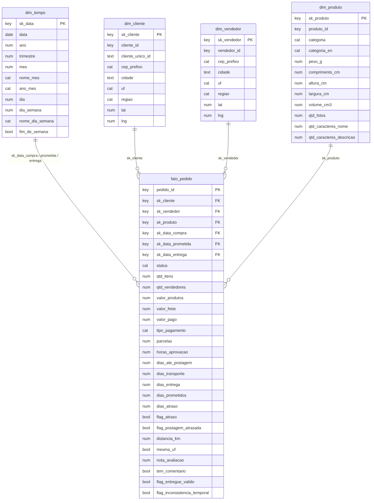

| Tabela | Linhas | Papel |
|---|---:|---|
| `fato_pedido` | 99.441 | Medidas de valor, prazo, atraso, distância e satisfação (30 atributos) |
| `dim_cliente` | 99.441 | Cliente do pedido e sua localização (UF, região, coordenadas) |
| `dim_vendedor` | 3.096 | Vendedor principal e sua localização (inclui o membro "desconhecido") |
| `dim_produto` | 32.952 | Produto principal: categoria, peso e dimensões (inclui "desconhecido") |
| `dim_tempo` | 801 | Calendário contínuo de set/2016 a nov/2018 (inclui "desconhecido") |

**Decisões de modelagem (regras G01–G09)**, detalhadas no notebook [`03_carga_gold`](notebooks/03_carga_gold.ipynb):

| Regra | Decisão |
|---|---|
| G01 | Pedidos com vários itens ou vendedores são atribuídos ao item de **maior preço** ("vendedor/produto principal"); o total de vendedores fica em `qtd_vendedores` |
| G02 | Os 775 pedidos sem itens apontam para o **membro desconhecido** (`sk = -1`), o que preserva a integridade referencial |
| G03 | **Atraso** = data da entrega > data prometida (a promessa é uma *data*, sem horário) |
| G04 | **Postagem atrasada** = postagem depois do maior prazo-limite de postagem dos itens do pedido |
| G05 | **Distância** em linha reta (fórmula de Haversine) entre os centroides de CEP do vendedor e do cliente |
| G06 | Durações em dias decimais, nulas quando o pedido tem inconsistência temporal |
| G07 | UF → macrorregião do IBGE |
| G08 | Chaves substitutas determinísticas; a `dim_tempo` usa `aaaammdd` |
| G09 | Pagamento: soma dos valores, tipo de maior valor e máximo de parcelas |

### 4.2 Catálogo de Dados

O catálogo completo, com **69 atributos**, está em **[`catalogo/catalogo_dados.md`](catalogo/catalogo_dados.md)**.
Para cada atributo ele traz tipo, descrição, **domínio esperado** (mínimo e máximo, ou categorias
válidas), obrigatoriedade, significado do nulo e **linhagem** (coluna de origem e regras aplicadas).

O catálogo é escrito uma única vez em [`catalogo/catalogo.yaml`](catalogo/catalogo.yaml) e cumpre
duas funções:
1. gera o documento legível (`scripts/gerar_catalogo.py`);
2. é lido pelo notebook de qualidade, que **verifica automaticamente** cada atributo contra o
   domínio declarado ([6.1](#61-qualidade-dos-dados)).

Assim, o catálogo deixa de ser só documentação e passa a ser um **contrato verificável**.

---

## 5. Carga (pipeline ETL)

### 5.1 Etapas

| Notebook | Etapa | Entrada → Saída | Abrir |
|---|---|---|---|
| [`00_pipeline`](notebooks/00_pipeline.ipynb) | **Orquestrador**: executa 01→05 e registra o log | — | [](https://colab.research.google.com/github/FilippeDumont/mvp-olist-atrasos-entrega/blob/main/notebooks/00_pipeline.ipynb) |
| [`01_coleta`](notebooks/01_coleta.ipynb) | Extração e validação | Kaggle → `raw/` + **Bronze** (9 tabelas) | [](https://colab.research.google.com/github/FilippeDumont/mvp-olist-atrasos-entrega/blob/main/notebooks/01_coleta.ipynb) |
| [`02_transformacao`](notebooks/02_transformacao.ipynb) | Transformação | Bronze → **Silver** (8 tabelas) | [](https://colab.research.google.com/github/FilippeDumont/mvp-olist-atrasos-entrega/blob/main/notebooks/02_transformacao.ipynb) |
| [`03_carga_gold`](notebooks/03_carga_gold.ipynb) | Modelagem e carga | Silver → **Gold** (estrela) + verificações | [](https://colab.research.google.com/github/FilippeDumont/mvp-olist-atrasos-entrega/blob/main/notebooks/03_carga_gold.ipynb) |
| [`04_qualidade`](notebooks/04_qualidade.ipynb) | Qualidade dos dados | Silver/Gold → `gold.dq_*` | [](https://colab.research.google.com/github/FilippeDumont/mvp-olist-atrasos-entrega/blob/main/notebooks/04_qualidade.ipynb) |
| [`05_analise`](notebooks/05_analise.ipynb) | Respostas P1–P6 | Gold → gráficos + `gold.resultados_indicadores` | [](https://colab.research.google.com/github/FilippeDumont/mvp-olist-atrasos-entrega/blob/main/notebooks/05_analise.ipynb) |

### 5.2 Regras de transformação (Bronze → Silver)

| Regra | Transformação | Por que importa para os resultados |
|---|---|---|
| R01 | **Tipagem**: texto → `timestamp`, `date`, `double` e `int` | Sem tipagem não há como calcular prazos |
| R02 | **Prefixo de CEP** como texto de 5 dígitos, com zeros à esquerda | Evita perder CEPs como `01001` e falhar a geolocalização |
| R03 | **Padronização**: UF em maiúsculas; cidade e categoria em minúsculas e sem espaços extras | Evita grupos duplicados por grafia |
| R04 | Colunas **renomeadas** para o português e erros de digitação da origem corrigidos (`lenght`) | Legibilidade |
| R05 | **Geolocalização**: descarta 42 coordenadas fora do Brasil; **mediana** por prefixo de CEP (1.000.163 → 19.010 linhas) | Distâncias corretas e robustas a valores extremos |
| R06 | **Deduplicação das avaliações**: 1 por pedido, a de resposta mais recente (99.224 → 98.673) | Evita contar notas em dobro na fato |
| R07 | **Produtos**: peso ou dimensão 0 → nulo; categoria ausente → `sem_categoria`; tradução manual de 2 categorias | Acurácia e completude |
| R08 | **Consistência temporal**: 203 pedidos com datas contraditórias são **sinalizados** (`dq_*`), não apagados | Excluídos das métricas de prazo, sem perder rastreabilidade |
| A01 | **Recorte de análise**: compras de jan/2017 a ago/2018, os 20 meses completos | Os meses das pontas têm volume residual ou pedidos ainda em trânsito ([6.1](#61-qualidade-dos-dados)) |

### 5.3 Junções e conciliação entre conjuntos de dados

A tabela fato reúne **seis conjuntos de dados** da origem. Como eles têm grãos diferentes, cada um é
primeiro **agregado ao grão do pedido** e só depois unido, o que evita duplicar linhas:

| Conjunto (Silver) | Grão original | Como entra na `fato_pedido` | Tipo de junção |
|---|---|---|---|
| `pedidos` | 1 por pedido | Base da fato: status, datas e flags de consistência | — |
| `itens_pedido` | 1 por item | Agregado por pedido: nº de itens e vendedores, soma de preço e frete, maior prazo-limite de postagem. O item de maior preço define o vendedor e o produto principais (G01) | `LEFT` (775 pedidos sem itens) |
| `pagamentos` | 1 por pagamento | Agregado por pedido: soma dos valores, tipo de maior valor, máximo de parcelas (G09) | `LEFT` (1 pedido sem pagamento) |
| `avaliacoes` | 1 por avaliação | Já deduplicado para 1 por pedido (R06) | `LEFT` (768 pedidos sem avaliação) |
| `clientes` / `vendedores` | 1 por cliente-pedido / vendedor | Chaves substitutas das dimensões e UF para a flag `mesma_uf` | `LEFT` |
| `geolocalizacao_cep` | 1 por prefixo de CEP | Coordenadas do cliente e do vendedor para a distância (G05) | `LEFT` (CEPs sem coordenada → distância nula) |

Todas as junções são `LEFT` a partir de `pedidos`, para que nenhum pedido se perca. A verificação
"linhas da fato = pedidos da Silver" (abaixo) comprova que nenhuma junção duplicou ou eliminou pedidos.

### 5.4 Verificações automáticas de carga

O notebook 03 **interrompe o pipeline** se alguma das verificações falhar:

| Verificação | Resultado |
|---|---|
| Linhas da fato = pedidos da Silver (unicidade do grão) | ✅ 99.441 = 99.441 |
| `pedido_id` único na fato | ✅ |
| Integridade referencial: 6 chaves estrangeiras (cliente, vendedor, produto e 3 datas) | ✅ 0 órfãos |

Ao todo, são **8 verificações** (2 de grão e 6 de chaves estrangeiras), todas aprovadas ([E5](#57-evidências-de-execução-na-nuvem)).

### 5.5 Log de execução

Cada etapa grava uma linha na tabela Delta `logs/pipeline_log`, com `run_id`, etapa, destino, linhas,
duração, status e ambiente. Uma execução completa produz **25 registros**, um por tabela gravada. Na execução
de 09/11/2026, o pipeline completo levou **4,4 minutos**.

### 5.6 Persistência na nuvem

Estrutura do lakehouse (no Colab, em `MyDrive/mvp_olist/`; na execução de 09/11/2026, no disco da VM, com os
artefatos de controle copiados para o Google Drive):

```
mvp_olist/
├── raw/        (126 MB)  CSVs originais + manifesto_coleta.json
├── bronze/     ( 65 MB)  9 tabelas Delta
├── silver/     ( 40 MB)  8 tabelas Delta
├── gold/       ( 16 MB)  5 tabelas do modelo + 2 de qualidade + 1 de indicadores
├── logs/                 pipeline_log (Delta)
└── evidencias/graficos/  8 gráficos PNG
```

### 5.7 Evidências de execução na nuvem

Capturas das **saídas reais** dos notebooks executados em 09/11/2026 na VM Linux em nuvem (ver a nota da seção 2).
Os notebooks com todas as saídas estão em [`notebooks/`](notebooks/).

**E1 · Coleta validada contra o contrato de dados:** 9 de 9 arquivos com as contagens e colunas oficiais (notebook 01).

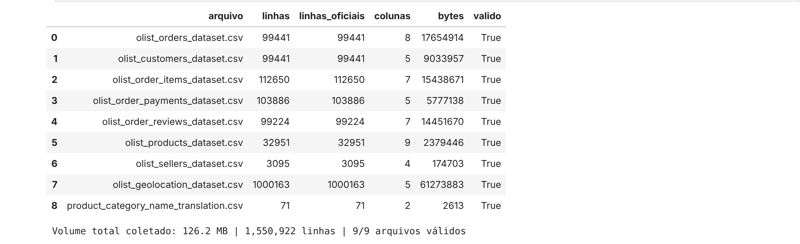

**E2 · Log do pipeline:** as 25 cargas da execução orquestrada, todas com SUCESSO (notebook 00).

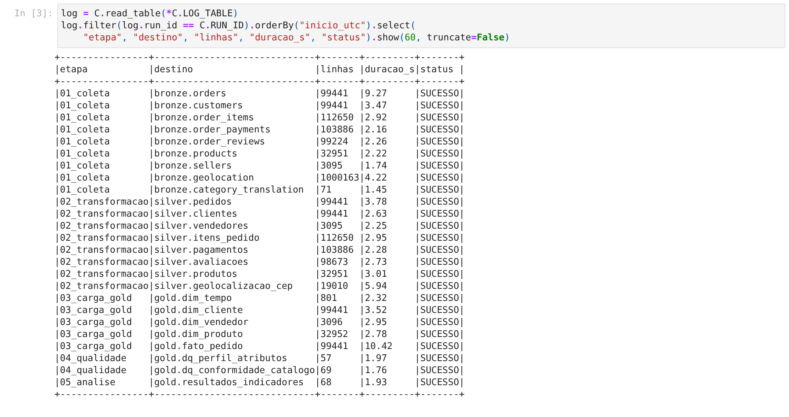

**E3 · Lakehouse persistido:** camadas raw, bronze, silver, gold e logs, com o tamanho de cada tabela (notebook 00).

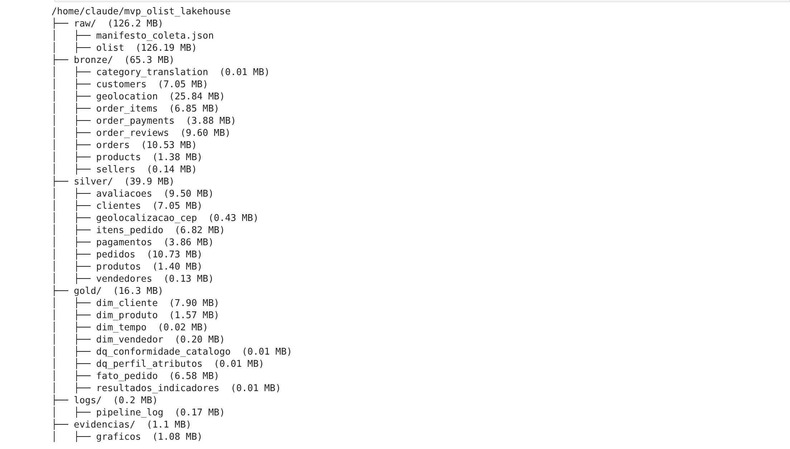

**E4 · Histórico de versões Delta da `fato_pedido`:** a carga gravada como versão do Delta Lake (notebook 00).

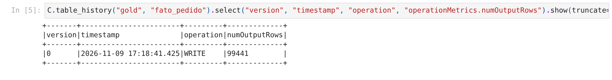

**E5 · Verificações de carga:** unicidade do grão e integridade das 6 chaves estrangeiras (notebook 03).

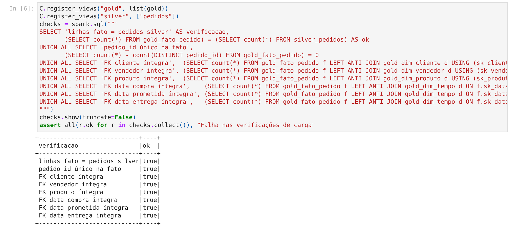

**E6 · Conclusão do pipeline ponta a ponta:** última etapa e tempo total (notebook 00).


**Artefatos gravados no Google Drive** (`MyDrive/mvp_olist/`): `manifesto_coleta.json` (data, fonte e SHA-256
da coleta), `pipeline_log.csv` (as duas execuções completas, 50 cargas) e `resultados_indicadores.csv`
(os 68 indicadores das perguntas P1–P6).

---

## 6. Análise

### 6.1 Qualidade dos dados

A análise completa está em [`04_qualidade`](notebooks/04_qualidade.ipynb). Ela cobre **todos os
atributos** da camada Silver (perfil de completude, cardinalidade e faixa) e verifica
**automaticamente os 69 atributos** da Gold contra o Catálogo de Dados.

| Dimensão | Principais achados | Tratamento |
|---|---|---|
| **Completude** | As datas ausentes correspondem a fases não atingidas (cancelado, em trânsito). Os 610 produtos sem categoria são os mesmos sem nome, descrição e fotos. Título e comentário das avaliações são opcionais (88% e 59% nulos). 279 CEPs de clientes não têm coordenada. A cidade da base de geolocalização foi descartada na Silver (grafia inconsistente e redundante) | Ausências legítimas documentadas no catálogo; categoria `sem_categoria`; distância nula só afeta a P2 |
| **Unicidade** | Todas as chaves das camadas Silver e Gold são únicas. Na origem: 814 `review_id` repetidos, 551 avaliações a mais em pedidos já avaliados e 261.831 linhas duplicadas na geolocalização | R06 (1 avaliação por pedido) e R05 (agregação por CEP) |
| **Consistência** | 0 registros órfãos entre tabelas. 203 pedidos (0,20%) com datas contraditórias, como postagem antes da compra (166) e entrega antes da postagem (23) | R08 sinaliza; G06 exclui das métricas de prazo |
| **Conformidade** | 11 de 69 atributos têm algum valor fora do domínio declarado. Cinco são de conformidade: cidades de vendedor com UF, país, CEP ou até e-mail no lugar do nome; pagamento `not_defined`; parcelas = 0. Os outros seis são prazos fora da faixa esperada (ver Acurácia) | Os atributos com problema de conformidade não entram nas perguntas; documentados |
| **Acurácia** | 42 coordenadas fora do Brasil; peso 0; prazo-limite de postagem em 2020; prazos extremos, como entregas acima de 120 dias (0,04%) | R05, R07; os prazos extremos são atrasos reais e foram mantidos, com uso de **medianas, percentuais e taxas**, robustos a extremos |
| **Atualidade** | As pontas do período estão incompletas: set–dez/2016 com poucos pedidos e set–out/2018 com só 20 pedidos, nenhum entregue. Os dados são de 2016–2018 | **A01:** análise de jan/2017 a ago/2018; atualidade discutida na autoavaliação |

**Conclusão da qualidade:** a base tem problemas reais, mas **localizados e tratáveis**. Os atributos
centrais das perguntas (datas de compra, postagem, entrega e promessa; nota; UF) estão completos e
coerentes em mais de 99,8% dos pedidos. Os problemas de conformidade estão em atributos que não entram
na análise, e os prazos extremos são tratados com estatísticas robustas.

### 6.2 Respostas às perguntas de negócio

Base de análise: **96.019 pedidos entregues** (jan/2017 a ago/2018) · **taxa de atraso geral: 6,80%**.
Todas as tabelas, testes e gráficos estão no notebook [`05_analise`](notebooks/05_analise.ipynb).

#### P1 · Quanto o atraso custa em satisfação? → **hipótese confirmada**

| Entrega | Pedidos avaliados | Nota média | % notas 1–2 | % notas 5 |
|---|---:|---:|---:|---:|
| No prazo | 89.001 | **4,29** | 9,2% | 62,3% |
| Atrasado | 6.376 | **2,27** | **62,4%** | 16,5% |

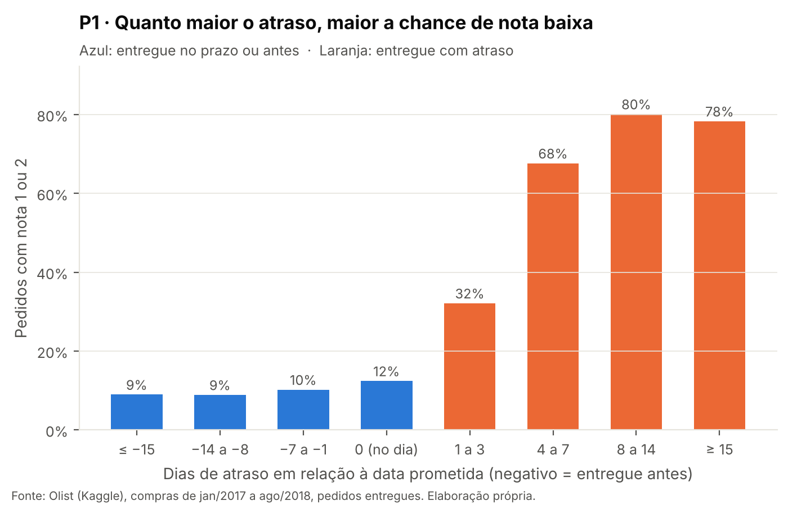

- O atraso multiplica o risco de nota baixa por **6,8**. Os testes de Mann-Whitney e qui-quadrado
  dão p < 0,001.
- A relação é **dose-resposta**: com 1 a 3 dias de atraso, 32% de notas baixas; com 4 a 7 dias, 68%;
  com mais de uma semana, cerca de 80%.
- O cliente **pune o atraso, mas não premia a antecipação**: entregar 15 dias antes rende a mesma
  nota que entregar 1 semana antes, com cerca de 9% de notas baixas.
- Na **regressão logística**, controlando valor, participação do frete, número de itens e de vendedores e região,
  a razão de chances (*odds ratio*) de nota baixa com atraso é **18,3** (IC 95%: 17,3–19,4). É o maior efeito do
  modelo, à frente de pedidos com vários vendedores (3,5) ou vários itens (2,7).
- Depois de controlar o atraso, a região do cliente **perde relevância**: a insatisfação regional
  passa *pelo* atraso.

#### P2 · Onde o atraso se concentra? → **parcialmente confirmada: a distância importa, mas o destino importa além dela**

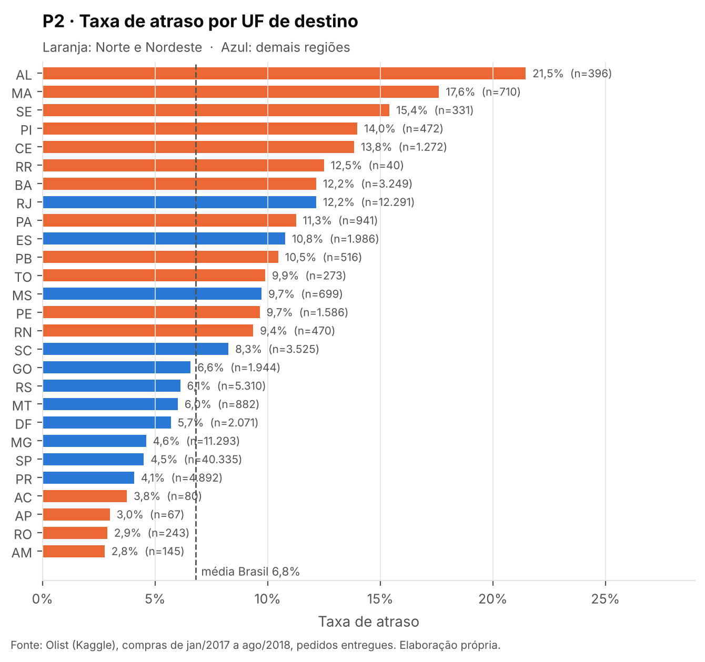

| Faixa de distância | < 100 km | 100–500 | 500–1.000 | 1.000–2.000 | ≥ 2.000 km |
|---|---:|---:|---:|---:|---:|
| Taxa de atraso | 4,5% | 6,1% | 7,2% | 9,5% | **12,1%** |

- **Por região:** o Nordeste tem **12,8%** de atraso, o dobro do Sudeste (6,1%). O Norte tem 8,6%.
- **Por distância:** o gradiente é claro (qui-quadrado, p < 0,001), mas a correlação individual é
  fraca (ρ = 0,07).
- **Na mesma faixa de distância (1.000–2.000 km)**, o Nordeste atrasa **12,9%** contra **5,8%** do
  Sudeste. O problema está no **destino**, ou seja, na última milha, e não apenas na distância.
- **O Rio de Janeiro surpreende:** mesmo perto do polo vendedor, de onde saem 83,5% dos pedidos, tem
  **12,2%** de atraso e responde sozinho por **22,9% de todos os atrasos**, quase o mesmo que São Paulo
  (27,8%), que recebe três vezes mais pedidos.
- **Tamanho da oportunidade:** se o RJ e os estados do Nordeste tivessem a taxa média do Sudeste
  (6,1%), cerca de **1.340 atrasos (20% do total)** deixariam de existir, e a taxa geral cairia de
  **6,8% para 5,4%**.

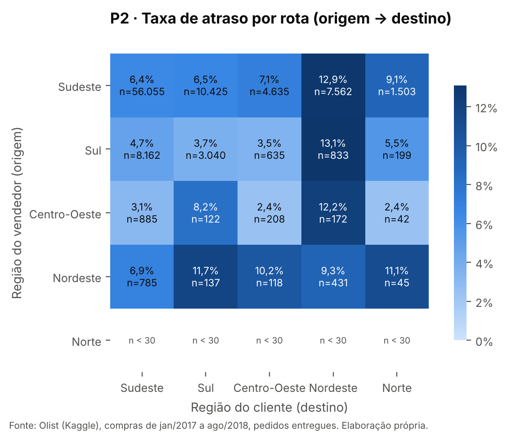

#### P3 · Quando o atraso acontece? → **parcialmente confirmada: o volume explica um pico, mas não todos**

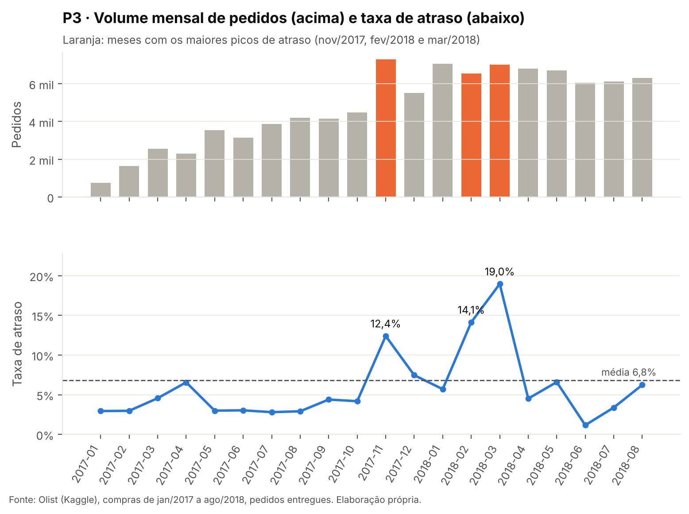

- Volume mensal e taxa de atraso têm correlação **moderada** (Spearman ρ = 0,57; p = 0,009).
- **Black Friday 2017:** na semana de 20 a 26/11, foram **416 pedidos por dia, contra 190** no resto de
  novembro. A taxa de atraso subiu para **17,3%, contra 9,2%**, com postagem e transporte mais lentos.
  É saturação de capacidade, como a hipótese previa.
- **Fevereiro e março de 2018** tiveram os maiores picos (**14,1% e 19,0%**) com volume parecido ao de
  janeiro, quando a taxa foi de só 5,7%. O tempo de postagem ficou estável e o de **transporte** subiu de 10,5 para cerca de
  13 dias: um choque externo. Em março, o pico coincide com a **greve nacional dos Correios iniciada
  em 12/03/2018** (Agência Brasil, 2018).

#### P4 · Quem causa o atraso? → **hipótese refutada: o principal elo é o transporte**

| Postagem pelo vendedor | Pedidos | Taxa de atraso | % de todos os atrasos |
|---|---:|---:|---:|
| No prazo | 87.448 | 5,4% | **72,3%** |
| Atrasada | 8.570 | **21,1%** | 27,7% |

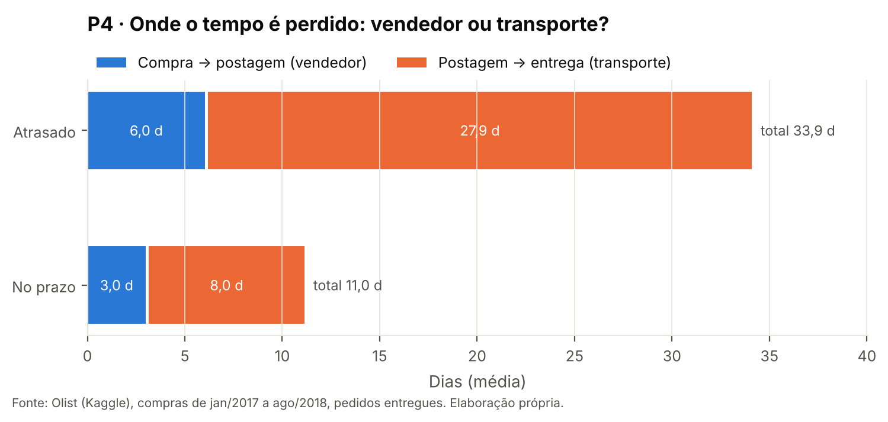

- Em **72%** dos atrasos, o vendedor postou o pacote **no prazo**.
- Dos ~23 dias a mais que um pedido atrasado leva, **19,9 estão no transporte** e só 3,0 na postagem.
  O transporte responde por **87% do tempo excedente**.
- O vendedor ainda importa: postar atrasado **quase quadruplica** o risco de atraso (21,1% contra 5,4%). Esses pedidos são só
  8,9% do total, um alvo pequeno e de alto retorno.

#### P5 · O prazo prometido está calibrado? → **parcialmente confirmada: a folga é grande e mal distribuída, mas não é desperdício**

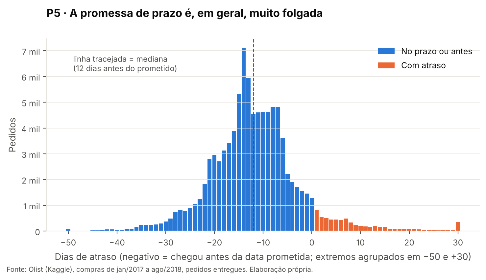

- A promessa mediana é de **24 dias** para uma entrega real mediana de **10 dias**. **79%** dos pedidos
  chegam com uma semana ou mais de antecedência.
- A folga está **mal distribuída**: as UFs com menos folga atrasam mais (ρ = −0,56; p = 0,003).
  Alagoas tem 10 dias de folga e **21,5%** de atraso; Amazonas tem 20 dias de folga e **2,8%**.
- **Resultado contra a hipótese.** Numa simulação **fora da amostra** (regra calibrada em 2017 e
  testada em 2018), prometer menos dias **sempre** custa mais atrasos. Uma regra por UF com o mesmo
  prazo médio da Olist (~23 dias) teria praticamente o mesmo atraso: cerca de 7,6%, contra 7,75%.
  A folga alta é o **preço da variabilidade do transporte**.

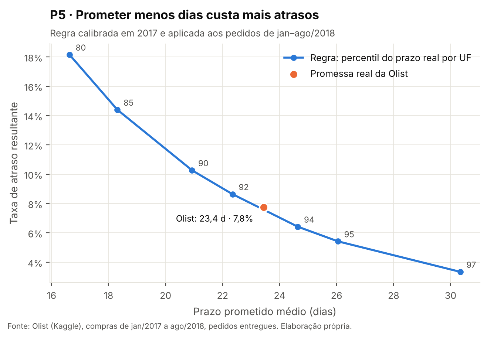

#### P6 · Dá para prever o risco de atraso na compra? *(exploratória)* → **resultado moderado: serve para triagem**

| Modelo (treino 2017 → teste jan–ago/2018) | AUC-ROC | Precisão média | Atraso no decil de maior risco | Lift |
|---|---:|---:|---:|---:|
| **Regressão logística** | **0,673** | 0,142 | **15,8%** | **2,0×** |
| Gradient boosting | 0,611 | 0,118 | 14,2% | 1,8× |
| *Taxa-base do teste* | — | 0,077 | 7,7% | 1,0× |

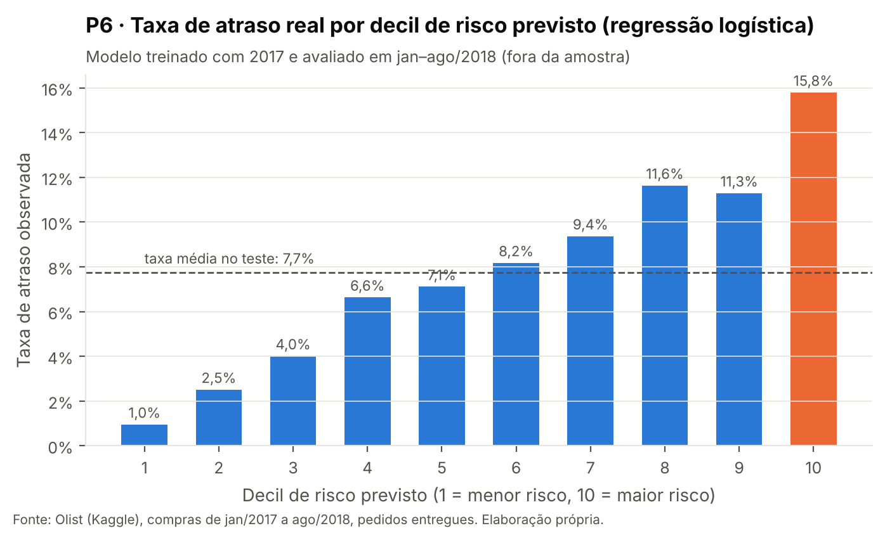

- O decil de maior risco previsto atrasa **o dobro da média** e concentra **20% de todos os atrasos**
  do período; o de menor risco atrasa só **1,0%**. Isso basta para **priorizar** pedidos, mas não para prever cada um.
- Os sinais mais fortes são a sazonalidade (novembro e dezembro), a rota (mesma UF protege) e o destino
  Nordeste.
- O limite do modelo são os choques externos, como a greve de 2018, que nenhuma variável disponível
  no ato da compra antecipa.

### 6.3 Discussão geral

A hipótese central foi **confirmada em sua maior parte**, com nuances que mudam a recomendação:

1. **O atraso é o principal fator de insatisfação medido.** Com ele, a nota baixa sobe de 9% para
   62% dos pedidos (razão de chances de 18,3), e a antecipação não compensa (P1).
2. **O atraso não é aleatório.** Ele se concentra em **destinos** (Nordeste e RJ, mesmo com distâncias
   iguais), em **períodos** (Black Friday e choques externos) e em **um elo**, o transporte (P2–P4).
3. **O atraso é gerenciável, mas não pelo caminho intuitivo.** O vendedor não é o principal culpado
   (P4) e a promessa de prazo já está perto do ótimo para uma regra simples (P5). A alavanca é
   **reduzir a variabilidade do transporte** nas rotas críticas, com a previsão de risco (P6) ajudando
   a priorizar onde agir.

| Prioridade | Ação recomendada | Evidência | Indicador a acompanhar |
|---|---|---|---|
| 1 | Acordo de nível de serviço com transportadoras por destino, focado em **RJ e Nordeste** | P2, P4 | Taxa de atraso por UF de destino; dias de transporte por rota |
| 2 | **Plano de capacidade** para datas comerciais (Black Friday) | P3 | Taxa de atraso nas semanas de pico |
| 3 | Promessa de prazo **por rota e época**, com folga proporcional à variabilidade | P5, P6 | Folga e taxa de atraso por rota |
| 4 | **Alerta proativo** ao cliente nos pedidos do decil de maior risco | P1, P6 | % de notas 1–2; atraso no decil de maior risco |
| 5 | Cobrança do prazo de postagem aos vendedores reincidentes | P4 | % de postagens no prazo por vendedor |

Cada ação tem um indicador para verificar se deu resultado, e todos podem ser calculados pelo mesmo
pipeline a partir da `fato_pedido`.

---

## 7. Autoavaliação

**1. Quais perguntas foram respondidas e quais não foram? Por quê?**
As seis perguntas foram respondidas com dados, mas com graus diferentes de confirmação, e os
resultados contrários estão registrados:

| Pergunta | Situação | Comentário |
|---|---|---|
| P1 | ✅ Confirmada | Efeito forte, robusto a controles e com dose-resposta |
| P2 | ◐ Parcialmente | A distância importa, mas o achado principal (destino, RJ) não estava previsto |
| P3 | ◐ Parcialmente | O volume explica a Black Friday, mas não fev–mar/2018. Esse pico só foi explicado com uma fonte externa, e o de fevereiro segue em aberto |
| P4 | ✗ Refutada | A hipótese apontava o vendedor; os dados apontam o transporte |
| P5 | ◐ Parcialmente | A folga existe e está mal distribuída, mas não é "desperdício" |
| P6 | ◐ Moderada | Útil para triagem (lift 2×), insuficiente para prever pedido a pedido |

**2. Que limitações dos dados condicionaram os resultados?**
- **Não há a transportadora** de cada pedido. Por isso, a P4 identifica o *elo* (transporte), mas não
  qual empresa atrasa. É a principal lacuna para transformar o achado em ação.
- **Atualidade:** os dados são de 2016–2018. O padrão logístico atual pode ser outro.
- **A distância é em linha reta** entre centroides de prefixo de CEP, não a rota rodoviária.
- **A nota mede tudo**, inclusive a qualidade do produto. A associação com o atraso é robusta, mas
  observacional: não prova causalidade.
- **Uma única empresa:** generalizar para o e-commerce brasileiro como um todo exige cautela.
- A regra que a Olist usa para calcular a data prometida não é conhecida, o que limita a P5.

**3. O que faria diferente se recomeçasse?**
- Teria um **plano B de plataforma** pronto desde o início. A falta de máquina no Colab gratuito no dia
  da execução mostrou que depender de um único ambiente gratuito é um risco operacional real.
- O volume (cerca de 100 mil pedidos) caberia em **pandas ou DuckDB**. O Spark foi mantido pela
  escalabilidade e pela aderência à disciplina, mas acrescenta cerca de 1 a 2 minutos de
  inicialização no Colab.
- Definiria o **recorte temporal (A01)** já na etapa de objetivo, e não depois da análise de qualidade.
- Incluiria desde o início a análise de **texto dos comentários** para confirmar que as notas baixas
  falam de entrega.

**4. Que extensões transformariam este MVP em uma solução de uso contínuo?**
- **Carga incremental** com `MERGE` do Delta Lake e agendamento, em vez da carga completa a cada execução.
- Incorporar **dados de transportadora e rastreio** para atribuir o atraso a cada operador.
- Publicar a **promessa de prazo dinâmica** (por rota e época) e o **escore de risco** da P6 como
  serviço, com monitoramento de *drift*.
- Um **painel** de taxa de atraso por rota, atualizado diariamente, com alertas para choques como greves.
- **Mineração de texto** dos comentários para separar a insatisfação logística da relacionada ao produto.

---

## 8. Como reproduzir

1. Abra o orquestrador no Colab: [](https://colab.research.google.com/github/FilippeDumont/mvp-olist-atrasos-entrega/blob/main/notebooks/00_pipeline.ipynb)
2. *Ambiente de execução → Executar tudo.*
3. Autorize o acesso ao Google Drive quando solicitado.
4. Ao final (5 a 15 minutos), o lakehouse estará em `MyDrive/mvp_olist/` e o log e o histórico de
   versões aparecem no fim do notebook.

Cada notebook (01 a 05) também pode ser aberto e executado **isoladamente** em uma sessão nova. Ele
lê do Drive o que a etapa anterior persistiu. Nenhuma credencial é necessária, porque o espelho público
é usado quando o Kaggle não está acessível. O catálogo é regenerado com `python scripts/gerar_catalogo.py`.

---

## 9. Estrutura do repositório

```
├── README.md                    ← este documento (objetivo, método, resultados, autoavaliação)
├── LICENSE                      ← MIT (código) + registro da licença dos dados
├── notebooks/
│   ├── 00_pipeline.ipynb        ← orquestrador (executa 01→05 e mostra log e persistência)
│   ├── 01_coleta.ipynb          ← extração, contrato de dados, Bronze
│   ├── 02_transformacao.ipynb   ← regras R01–R08, Silver
│   ├── 03_carga_gold.ipynb      ← esquema estrela, regras G01–G09, verificações
│   ├── 04_qualidade.ipynb       ← qualidade por atributo e conformidade ao catálogo
│   └── 05_analise.ipynb         ← P1–P6, testes estatísticos, gráficos, discussão
├── scripts/
│   ├── common.py                ← Spark + Delta, persistência, log do pipeline
│   ├── graficos.py              ← padrão visual dos gráficos
│   └── gerar_catalogo.py        ← gera o catálogo a partir do YAML
├── catalogo/
│   ├── catalogo.yaml            ← fonte única dos metadados (69 atributos)
│   ├── catalogo_dados.md        ← Catálogo de Dados (domínios e linhagem)
│   ├── modelo_estrela.png       ← diagrama do modelo
│   └── linhagem.png             ← diagrama da linhagem
└── evidencias/
    ├── graficos/                ← 8 gráficos das respostas (P1–P6)
    └── execucao/                ← capturas das saídas reais da execução (E1–E6)
```

---

## 10. Ética, licenças e proteção de dados

- **Licença dos dados:** CC BY-NC-SA 4.0. O uso aqui é **acadêmico e não comercial**, com atribuição
  à Olist. Os dados brutos **não são versionados** neste repositório; o notebook `01_coleta` reproduz
  a coleta.
- **Dados pessoais (LGPD, Lei nº 13.709/2018):** a base é **anonimizada na origem**. Clientes,
  vendedores e pedidos aparecem como *hashes*, a localização vai só até o prefixo de 5 dígitos do CEP
  e nomes de empresas foram substituídos na origem. Nenhum procedimento de reidentificação foi tentado,
  e os comentários livres das avaliações não são exibidos.
- **Dados corporativos:** não foram usados.
- **Licença do código:** MIT (ver [`LICENSE`](LICENSE)).

---

## 11. Referências

- OLIST. *Brazilian E-Commerce Public Dataset by Olist.* Kaggle, 2018. Disponível em: <https://www.kaggle.com/datasets/olistbr/brazilian-ecommerce>.
- AGÊNCIA BRASIL. *Saiba o que fazer para ficar com contas em dia durante greve dos Correios.* 12 mar. 2018. Disponível em: <https://agenciabrasil.ebc.com.br/geral/noticia/2018-03/saiba-o-que-fazer-para-ficar-com-contas-em-dia-durante-greve-dos-correios>.
- KIMBALL, R.; ROSS, M. *The Data Warehouse Toolkit: The Definitive Guide to Dimensional Modeling.* 3. ed. Wiley, 2013.
- ARMBRUST, M. et al. Delta Lake: High-Performance ACID Table Storage over Cloud Object Stores. *Proceedings of the VLDB Endowment*, v. 13, n. 12, 2020.
- RIES, E. *The Lean Startup.* Crown Business, 2011.
- BRASIL. Lei nº 13.709, de 14 de agosto de 2018 (Lei Geral de Proteção de Dados Pessoais).
