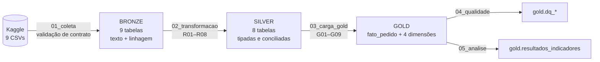
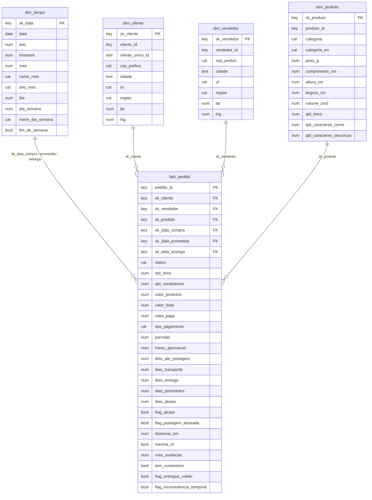

# Catálogo de Dados

> Documento gerado automaticamente a partir de [`catalogo.yaml`](catalogo.yaml) por [`scripts/gerar_catalogo.py`](../scripts/gerar_catalogo.py). Os **domínios** abaixo são expectativas de negócio definidas *a priori* e são verificados automaticamente no notebook [`04_qualidade`](../notebooks/04_qualidade.ipynb).

## 1. Fonte e licença

| Item | Valor |
|---|---|
| Conjunto de dados | Brazilian E-Commerce Public Dataset by Olist |
| Origem | <https://www.kaggle.com/datasets/olistbr/brazilian-ecommerce> |
| Licença | CC BY-NC-SA 4.0: uso não comercial, com atribuição e compartilhamento pela mesma licença |
| Período coberto | 2016-09 a 2018-10 |
| Coleta | notebooks/01_coleta.ipynb (data, volume e checksums em raw/manifesto_coleta.json) |

## 2. Linhagem (visão geral)

| Tabela Gold | Tabelas Silver de origem | Tabelas Bronze / arquivos de origem |
|---|---|---|
| `fato_pedido` | pedidos, itens_pedido, pagamentos, avaliacoes, geolocalizacao_cep | orders, order_items, order_payments, order_reviews, geolocation |
| `dim_cliente` | clientes, geolocalizacao_cep | customers, geolocation |
| `dim_vendedor` | vendedores, geolocalizacao_cep | sellers, geolocation |
| `dim_produto` | produtos | products, category_translation |
| `dim_tempo` | pedidos (limites de datas) | gerada |

Toda linha da camada Bronze carrega `_arquivo_origem`, `_data_coleta` e `_run_id`. Os códigos R01–R08 (transformação) e G01–G09 (modelagem) referem-se às regras documentadas nos notebooks [`02_transformacao`](../notebooks/02_transformacao.ipynb) e [`03_carga_gold`](../notebooks/03_carga_gold.ipynb).

## 3. Modelo de dados (Esquema Estrela)

## 4. Dicionário por tabela

### `fato_pedido`

Tabela fato. Grão = 1 pedido (todos os status). Medidas de valor, prazo, atraso, distância e satisfação.

**Chave:** `pedido_id`

| Atributo | Tipo | Descrição | Domínio esperado | Obrigatório | Significado do nulo | Linhagem |
|---|---|---|---|---|---|---|
| `pedido_id` | chave | Identificador do pedido (hash anonimizado) | padrão `^[0-9a-f]{32}$` | sim | — | bronze.orders.order_id |
| `sk_cliente` | chave | Chave estrangeira para dim_cliente | 1 a 1000000 | sim | — | G08 sobre bronze.orders.customer_id |
| `sk_vendedor` | chave | Chave estrangeira para dim_vendedor (vendedor principal, G01); -1 = pedido sem itens | -1 a 1000000 | sim | — | G01, G02, G08 sobre bronze.order_items.seller_id |
| `sk_produto` | chave | Chave estrangeira para dim_produto (produto principal, G01); -1 = pedido sem itens | -1 a 1000000 | sim | — | G01, G02, G08 sobre bronze.order_items.product_id |
| `sk_data_compra` | chave | Data da compra (aaaammdd) -> dim_tempo | 20160101 a 20181231 | sim | — | bronze.orders.order_purchase_timestamp (R01) |
| `sk_data_prometida` | chave | Data de entrega prometida ao cliente (aaaammdd) -> dim_tempo | 20160101 a 20181231 | sim | — | bronze.orders.order_estimated_delivery_date (R01) |
| `sk_data_entrega` | chave | Data da entrega efetiva (aaaammdd) -> dim_tempo; -1 = não entregue | -1 a 20181231 | sim | — | bronze.orders.order_delivered_customer_date (R01, G02) |
| `status` | categórico | Situação do pedido no momento da extração | `created`, `approved`, `invoiced`, `processing`, `shipped`, `delivered`, `canceled`, `unavailable` | sim | — | bronze.orders.order_status (R03) |
| `qtd_itens` | numérico | Número de itens do pedido | 0 a 30 | sim | — | contagem de bronze.order_items por pedido |
| `qtd_vendedores` | numérico | Número de vendedores distintos no pedido | 0 a 10 | sim | — | contagem distinta de bronze.order_items.seller_id |
| `valor_produtos` | numérico | Soma dos preços dos itens (R$) | 0.01 a 15000 | não | pedido sem itens | soma de bronze.order_items.price |
| `valor_frete` | numérico | Soma do frete dos itens (R$) | 0 a 2000 | não | pedido sem itens | soma de bronze.order_items.freight_value |
| `valor_pago` | numérico | Soma de todos os pagamentos do pedido (R$) | 0.01 a 15000 | não | pedido sem pagamento registrado | G09: soma de bronze.order_payments.payment_value |
| `tipo_pagamento` | categórico | Meio de pagamento de maior valor no pedido | `credit_card`, `boleto`, `voucher`, `debit_card` | não | pedido sem pagamento registrado | G09 sobre bronze.order_payments.payment_type |
| `parcelas` | numérico | Maior número de parcelas entre os pagamentos do pedido | 1 a 24 | não | pedido sem pagamento registrado | G09 sobre bronze.order_payments.payment_installments |
| `horas_aprovacao` | numérico | Horas entre a compra e a aprovação do pagamento | 0 a 720 | não | não aprovado ou inconsistência temporal (G06) | orders.order_approved_at - order_purchase_timestamp |
| `dias_ate_postagem` | numérico | Dias entre a compra e a entrega do pacote à transportadora | 0 a 60 | não | não postado ou inconsistência temporal (G06) | orders.order_delivered_carrier_date - order_purchase_timestamp |
| `dias_transporte` | numérico | Dias entre a postagem e a entrega ao cliente (trecho da transportadora) | 0 a 90 | não | não entregue ou inconsistência temporal (G06) | orders.order_delivered_customer_date - order_delivered_carrier_date |
| `dias_entrega` | numérico | Prazo total efetivo da compra até a entrega | 0 a 120 | não | não entregue ou inconsistência temporal (G06) | orders.order_delivered_customer_date - order_purchase_timestamp |
| `dias_prometidos` | numérico | Prazo prometido ao cliente no ato da compra (dias corridos) | 1 a 90 | sim | — | orders.order_estimated_delivery_date - data(order_purchase_timestamp) |
| `dias_atraso` | numérico | Data da entrega menos data prometida; negativo = adiantado (folga) | -90 a 120 | não | pedido não entregue de forma válida | G03 |
| `flag_atraso` | booleano | Pedido entregue depois da data prometida (dias_atraso > 0) | `True`, `False` | não | pedido não entregue de forma válida | G03 |
| `flag_postagem_atrasada` | booleano | Vendedor entregou à transportadora depois do prazo-limite de postagem | `True`, `False` | não | não postado ou inconsistência temporal | G04: orders.order_delivered_carrier_date > max(order_items.shipping_limit_date) |
| `distancia_km` | numérico | Distância em linha reta entre os CEPs do vendedor principal e do cliente | 0 a 4500 | não | CEP sem coordenada ou pedido sem itens | G05 (Haversine) sobre silver.geolocalizacao_cep (R05) |
| `mesma_uf` | booleano | Vendedor principal e cliente estão na mesma UF | `True`, `False` | não | pedido sem itens | customers.customer_state = sellers.seller_state |
| `nota_avaliacao` | numérico | Nota dada pelo cliente na pesquisa de satisfação (1 a 5) | 1 a 5 | não | pedido sem avaliação | R06 sobre bronze.order_reviews.review_score |
| `tem_comentario` | booleano | A avaliação contém comentário escrito | `True`, `False` | não | pedido sem avaliação | R06 sobre bronze.order_reviews.review_comment_message |
| `flag_entregue_valido` | booleano | Pedido entregue, com data de entrega e sem inconsistência temporal (base das análises de prazo) | `True`, `False` | sim | — | status = delivered e não R08 |
| `flag_inconsistencia_temporal` | booleano | Pedido com datas contraditórias (R08) | `True`, `False` | sim | — | R08 sobre bronze.orders |

### `dim_cliente`

Dimensão cliente (1 linha por customer_id, ou seja, por pedido; cliente_unico_id identifica a pessoa).

**Chave:** `sk_cliente`

| Atributo | Tipo | Descrição | Domínio esperado | Obrigatório | Significado do nulo | Linhagem |
|---|---|---|---|---|---|---|
| `sk_cliente` | chave | Chave substituta | 1 a 1000000 | sim | — | G08 |
| `cliente_id` | chave | Identificador do cliente no pedido (hash) | padrão `^[0-9a-f]{32}$` | sim | — | bronze.customers.customer_id |
| `cliente_unico_id` | texto | Identificador da pessoa (permite identificar recompra) | padrão `^[0-9a-f]{32}$` | sim | — | bronze.customers.customer_unique_id |
| `cep_prefixo` | categórico | 5 primeiros dígitos do CEP | padrão `^[0-9]{5}$` | sim | — | bronze.customers.customer_zip_code_prefix (R02) |
| `cidade` | texto | Município do cliente | padrão `^[a-zà-ú' \-]+$` | sim | — | bronze.customers.customer_city (R03) |
| `uf` | categórico | Unidade da Federação | `AC`, `AL`, `AP`, `AM`, `BA`, `CE`, `DF`, `ES`, `GO`, `MA`, `MT`, `MS`, `MG`, `PA`, `PB`, `PR`, `PE`, `PI`, `RJ`, `RN`, `RS`, `RO`, `RR`, `SC`, `SP`, `SE`, `TO` | sim | — | bronze.customers.customer_state (R03) |
| `regiao` | categórico | Macrorregião do IBGE | `Norte`, `Nordeste`, `Centro-Oeste`, `Sudeste`, `Sul` | sim | — | G07 sobre uf |
| `lat` | numérico | Latitude do centroide do prefixo de CEP | -33.8 a 5.3 | não | CEP ausente da base de geolocalização | R05 sobre bronze.geolocation |
| `lng` | numérico | Longitude do centroide do prefixo de CEP | -74.0 a -34.7 | não | CEP ausente da base de geolocalização | R05 sobre bronze.geolocation |

### `dim_vendedor`

Dimensão vendedor (1 linha por vendedor; sk = -1 representa "desconhecido", G02).

**Chave:** `sk_vendedor`

| Atributo | Tipo | Descrição | Domínio esperado | Obrigatório | Significado do nulo | Linhagem |
|---|---|---|---|---|---|---|
| `sk_vendedor` | chave | Chave substituta | -1 a 1000000 | sim | — | G08 |
| `vendedor_id` | chave | Identificador do vendedor (hash) | padrão `^([0-9a-f]{32}\|desconhecido)$` | sim | — | bronze.sellers.seller_id |
| `cep_prefixo` | categórico | 5 primeiros dígitos do CEP | padrão `^([0-9]{5}\|desconhecido)$` | sim | — | bronze.sellers.seller_zip_code_prefix (R02) |
| `cidade` | texto | Município do vendedor | padrão `^[a-zà-ú' \-]+$` | sim | — | bronze.sellers.seller_city (R03) |
| `uf` | categórico | Unidade da Federação | `AC`, `AL`, `AP`, `AM`, `BA`, `CE`, `DF`, `ES`, `GO`, `MA`, `MT`, `MS`, `MG`, `PA`, `PB`, `PR`, `PE`, `PI`, `RJ`, `RN`, `RS`, `RO`, `RR`, `SC`, `SP`, `SE`, `TO`, `desconhecido` | sim | — | bronze.sellers.seller_state (R03) |
| `regiao` | categórico | Macrorregião do IBGE | `Norte`, `Nordeste`, `Centro-Oeste`, `Sudeste`, `Sul`, `desconhecido` | sim | — | G07 sobre uf |
| `lat` | numérico | Latitude do centroide do prefixo de CEP | -33.8 a 5.3 | não | CEP ausente da base de geolocalização | R05 sobre bronze.geolocation |
| `lng` | numérico | Longitude do centroide do prefixo de CEP | -74.0 a -34.7 | não | CEP ausente da base de geolocalização | R05 sobre bronze.geolocation |

### `dim_produto`

Dimensão produto (1 linha por produto; sk = -1 representa "desconhecido", G02).

**Chave:** `sk_produto`

| Atributo | Tipo | Descrição | Domínio esperado | Obrigatório | Significado do nulo | Linhagem |
|---|---|---|---|---|---|---|
| `sk_produto` | chave | Chave substituta | -1 a 1000000 | sim | — | G08 |
| `produto_id` | chave | Identificador do produto (hash) | padrão `^([0-9a-f]{32}\|desconhecido)$` | sim | — | bronze.products.product_id |
| `categoria` | categórico | Categoria do produto em português (sem_categoria quando ausente na origem) | padrão `^[a-z0-9_]+$` | sim | — | bronze.products.product_category_name (R03, R07) |
| `categoria_en` | categórico | Categoria em inglês | padrão `^[a-z0-9_]+$` | sim | — | bronze.category_translation (R07, tradução manual de 2 categorias) |
| `peso_g` | numérico | Peso do produto em gramas | 1 a 50000 | não | ausente ou igual a 0 na origem (R07) | bronze.products.product_weight_g |
| `comprimento_cm` | numérico | Comprimento da embalagem (cm) | 1 a 200 | não | ausente na origem | bronze.products.product_length_cm |
| `altura_cm` | numérico | Altura da embalagem (cm) | 1 a 200 | não | ausente na origem | bronze.products.product_height_cm |
| `largura_cm` | numérico | Largura da embalagem (cm) | 1 a 200 | não | ausente na origem | bronze.products.product_width_cm |
| `volume_cm3` | numérico | Volume da embalagem (comprimento x altura x largura) | 1 a 8000000 | não | alguma dimensão ausente | derivado das três dimensões |
| `qtd_fotos` | numérico | Quantidade de fotos no anúncio | 1 a 30 | não | ausente na origem (produtos sem categoria) | bronze.products.product_photos_qty |
| `qtd_caracteres_nome` | numérico | Tamanho do nome do produto | 1 a 200 | não | ausente na origem | bronze.products.product_name_lenght (R04) |
| `qtd_caracteres_descricao` | numérico | Tamanho da descrição do produto | 1 a 10000 | não | ausente na origem | bronze.products.product_description_lenght (R04) |

### `dim_tempo`

Calendário contínuo (role-playing para datas de compra, prometida e entrega; sk = -1 representa data ausente).

**Chave:** `sk_data`

| Atributo | Tipo | Descrição | Domínio esperado | Obrigatório | Significado do nulo | Linhagem |
|---|---|---|---|---|---|---|
| `sk_data` | chave | Data no formato aaaammdd | -1 a 20181231 | sim | — | gerado (sequence) |
| `data` | data | Data do calendário | 2016-01-01 a 2018-12-31 | não | membro desconhecido | gerado |
| `ano` | numérico | Ano | 2016 a 2018 | não | membro desconhecido | derivado de data |
| `trimestre` | numérico | Trimestre | 1 a 4 | não | membro desconhecido | derivado de data |
| `mes` | numérico | Mês | 1 a 12 | não | membro desconhecido | derivado de data |
| `nome_mes` | categórico | Nome do mês | `janeiro`, `fevereiro`, `março`, `abril`, `maio`, `junho`, `julho`, `agosto`, `setembro`, `outubro`, `novembro`, `dezembro`, `desconhecido` | sim | — | derivado de data |
| `ano_mes` | categórico | Ano e mês (aaaa-mm) | padrão `^(20[0-9]{2}-[0-9]{2}\|desconhecido)$` | sim | — | derivado de data |
| `dia` | numérico | Dia do mês | 1 a 31 | não | membro desconhecido | derivado de data |
| `dia_semana` | numérico | Dia da semana (1 = domingo ... 7 = sábado) | 1 a 7 | não | membro desconhecido | derivado de data |
| `nome_dia_semana` | categórico | Nome do dia da semana | `domingo`, `segunda`, `terça`, `quarta`, `quinta`, `sexta`, `sábado`, `desconhecido` | sim | — | derivado de data |
| `fim_de_semana` | booleano | Sábado ou domingo | `True`, `False` | não | membro desconhecido | derivado de data |
